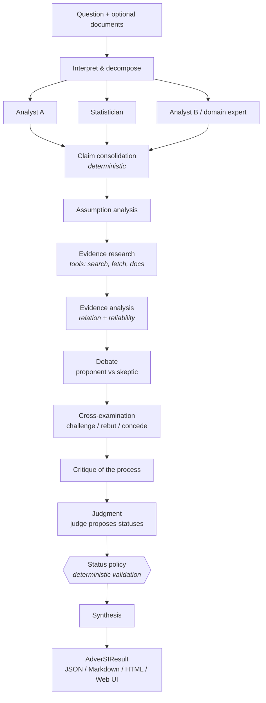
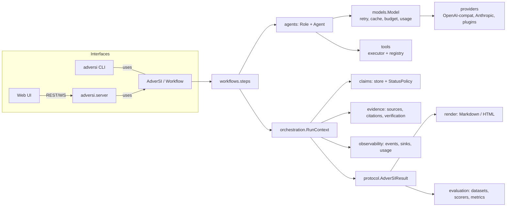

<p align="center">
  
</p>

<h1 align="center">AdverSI</h1>

<p align="center"><b>An open-source framework for building adversarial, evidence-aware multi-agent AI systems.</b><br>
Independent reasoning. Adversarial critique. Evidence. Synthesis.</p>

---

AdverSI (*Adversarial Super Intelligence*, a name for the goal, not a claim) is a Python
framework for making AI systems challenge their own reasoning. Instead of
`question -> model -> answer`, an AdverSI workflow has several agents reason
**independently**, break their positions into **typed claims**, ground those claims in
**verified evidence**, **cross-examine** each other, and hand a judge a complete record
whose conclusions are then **checked by deterministic rules** before a final synthesis.

It is built to be **measured**, not admired. Every run produces a structured, inspectable
result (claims, evidence with provenance, challenges, critique, uncertainty signals, full
event trace, token usage), and an evaluation harness compares workflows against a
single-model baseline on your own data. Whether adversarial multi-agent reasoning actually
helps is treated as an open question. See [docs/research.md](docs/research.md).

> **Status:** alpha (0.1). The protocol, workflow engine, providers, tools, CLI, web UI and
> evaluation harness work and are tested. APIs may change before 1.0; the result schema is
> versioned. No benchmark results are published yet because none have been run.

## Why

Single-model answers hide three things: what was actually claimed, what supports it, and
where the model is unsure. Asking the model to "think harder" produces longer text, not
more checkable text. AdverSI's design bets are:

| Principle | What AdverSI does about it |
|---|---|
| Independent reasoning | Analysts run concurrently on identical inputs; no agent sees another's output until the independent stage is complete. |
| Adversarial reasoning | Skeptics challenge *specific claim ids*; defenders answer or concede; concessions affect status. |
| Evidence over confidence | A claim is `supported` only with a verified external excerpt. Agent confidence and agreement do not count as evidence. |
| Structured reasoning | Agents emit claims, assumptions, citations, counterarguments and confidence as validated JSON, not prose. |
| Transparency | Every result records sources, provenance, rejected citations, policy adjustments, and a full event trace. No hidden chain-of-thought is requested or shown. |
| Model and tool independence | Providers and tools are small interfaces with registries and entry-point plugins. |

## How it works



Two mechanisms keep the output honest:

1. **Citation verification.** Only the system creates sources (user documents, tool
   outputs, fetched pages). Agents cite them by id with a verbatim excerpt, which is
   checked against the source text. Unverifiable citations are rejected and counted
   (`citation_rejection_rate`). Model knowledge can be cited but is labelled as such and
   never counts as external evidence.
2. **Status policy.** The judge only *proposes* claim statuses. `StatusPolicy` downgrades
   proposals the evidence graph cannot justify (e.g. `supported` without verified external
   support becomes `uncertain`) and records why. Multiple judges are never majority-voted:
   disagreement yields `uncertain`.

## Install

Requires Python 3.11+. The core depends only on `pydantic` and `httpx`.

```bash
pip install adversi                 # core + CLI
pip install "adversi[server]"       # + web UI / API server
pip install "adversi[yaml]"         # + YAML config files
```

From source:

```bash
git clone https://github.com/Yashjindal11/adversi && cd adversi
python -m venv .venv && . .venv/bin/activate
pip install -e ".[dev]"
```

## Quickstart

```bash
export OPENAI_API_KEY=...   # or ANTHROPIC_API_KEY / GEMINI_API_KEY / HF_TOKEN, or run Ollama locally
adversi run "Does a four-day work week improve productivity at software companies?" \
  --model openai:gpt-4o-mini --profile fast --tool fetch_url --save result.json
adversi inspect result.json --claims
```

```python
from adversi import AdverSI

ai = AdverSI("openai:gpt-4o-mini", mode="research", profile="fast", tools=["calculator", "fetch_url"])
result = ai.run_sync("Does a four-day work week improve productivity at software companies?")

print(result.answer)
for claim in result.claims:
    print(claim.id, claim.status.value, claim.statement)
print(result.to_markdown())
```

No API key? `python examples/offline_demo.py` runs the full workflow against a scripted
model so you can see the machinery and the result format (the answers are hard-coded).

## Providers

Model specs are `provider:model`. Different agents can use different providers.

| Provider | Spec example | Credentials | Notes |
|---|---|---|---|
| `openai` | `openai:gpt-4o-mini` | `OPENAI_API_KEY` | Native JSON schema + tool calling |
| `anthropic` | `anthropic:claude-sonnet-4-5` | `ANTHROPIC_API_KEY` | Messages API; schema enforced by validation + repair |
| `gemini` | `gemini:gemini-2.0-flash` | `GEMINI_API_KEY` | Via Google's OpenAI-compatible endpoint |
| `ollama` | `ollama:llama3.1:8b` | none | Local models |
| `huggingface` | `huggingface:meta-llama/Llama-3.1-8B-Instruct` | `HF_TOKEN` | HF Inference router or a TGI `base_url` |
| `openai_compatible` | `openai_compatible:qwen2.5` | optional | vLLM, LM Studio, llama.cpp, gateways (set `base_url`) |
| custom | anything | yours | `register_provider()` or the `adversi.providers` entry point |

`adversi providers` shows which are configured. Retries, timeouts, rate limits,
concurrency, caching, token and cost accounting are implemented once in `adversi.Model`,
not per provider. AdverSI ships no price table (prices change); configure prices to get
cost tracking, otherwise cost is reported as unknown. Details: [docs/providers.md](docs/providers.md).

## Reasoning modes

| Mode | Steps | Model calls (balanced) |
|---|---|---|
| `simple` | one analysis | 1 (single-model baseline) |
| `debate` | analysis, proponent vs skeptic, judge, synthesis | ~7 |
| `adversarial` | independent analysts, consolidation, cross-examination, critique, judge, synthesis | ~8 |
| `research` (default) | everything in the diagram above | ~16 + tool calls |
| `peer_review` | independent analysts, structured position exchange, critique, judge, synthesis | ~9 |
| `jury` | independent analysts, cross-examination, several independent judges | ~9 |

Profiles `fast | balanced | deep` set the number of analysts, debate and cross-examination
rounds, research breadth and tool-call budget. Any value can be overridden, and
`Budget(max_total_tokens=..., max_cost_usd=..., max_model_calls=...)` hard-stops a run
(the partial result is still returned). See [docs/workflows.md](docs/workflows.md).

## Custom workflows and agents

```python
from adversi import Agent, Role, Workflow, domain_expert, steps

red_team = Role("red_team", "Assume the plan fails within a year; list the most plausible causes as claims.")

workflow = Workflow(
    [
        steps.IndependentAnalysis([
            Agent("analyst"),
            Agent(domain_expert("airline operations")),
            Agent(red_team, model="anthropic:claude-sonnet-4-5"),
        ]),
        steps.ClaimConsolidation(),
        steps.EvidenceResearch(max_claims=5),
        steps.CrossExamination(rounds=2),
        steps.Judgment([Agent("judge", name="j1"), Agent("judge", name="j2", model="gemini:gemini-2.0-flash")]),
        steps.Synthesis(),
    ],
    model="openai:gpt-4o-mini",          # default for agents without their own model
    models={"skeptic": "ollama:llama3.1:8b"},  # per-role / per-agent overrides
    tools=[...],
)
result = workflow.run_sync("Should we proactively cancel flights ahead of the storm?")
```

A step is a class with an async `run(ctx)` that reads and writes the shared run context;
see [examples/06_custom_agent.py](examples/06_custom_agent.py) for a custom step.

## Tools

```python
from adversi import tool, SourceType

@tool(source_type=SourceType.DATABASE)
def delay_rate(airport: str, month: str) -> str:
    """Monthly delay statistics for an airport."""
    ...
```

The signature becomes a validated JSON schema; calls are timeout-bounded and errors are
returned to the model rather than crashing the run. Built-ins: `calculator` (AST-based,
no `eval`), `fetch_url` (SSRF-guarded, size-limited, HTML to text), `web_search`
(pluggable backend; Brave included), and `search_documents` (BM25 over user documents,
added automatically when documents are long). See [docs/tools.md](docs/tools.md).

## CLI

```text
adversi init                         create adversi.toml
adversi run "<question>" [opts]      run a workflow (--mode, --profile, --model, --tool, --doc, -f json|markdown|html)
adversi debate "<question>"          shortcut for --mode debate
adversi inspect result.json          summarise claims, evidence, challenges, errors, events
adversi report result.json -f html   render a saved result
adversi providers                    list providers and credential status
adversi config validate              validate config and print the resolved workflow
adversi benchmark data.jsonl         (experimental) compare modes on a dataset
adversi evaluate out/ data.jsonl     (experimental) re-score saved benchmark results
adversi serve                        start the web UI on http://127.0.0.1:8765
```

Configuration lives in `adversi.toml` (or YAML). API keys are only read from environment
variables; the config schema rejects them. See [docs/configuration.md](docs/configuration.md).

## Web UI

`adversi serve` starts a local FastAPI server with a React + TypeScript UI: submit a
question, watch the event trace live over WebSocket, then explore the synthesis, the
claim graph (evidence, claims, challenges, assumptions), evidence with provenance and
rejected citations, agent perspectives, debate and cross-examination, critique,
uncertainty signals and run metadata. Saved result JSON files can be opened without a
server. The server has no authentication and binds to localhost. See [docs/web.md](docs/web.md).

## Architecture



Dependencies point inward: the core never imports the CLI, server or UI, and no core
module imports a specific provider. Full write-up and design decisions:
[docs/architecture.md](docs/architecture.md) and [docs/decisions.md](docs/decisions.md).

## Evaluation

`adversi benchmark` runs several modes on a JSONL dataset and reports accuracy with Wilson
95% intervals, Brier score, ECE, whether verdict disagreement predicts errors (AUROC),
tokens, cost and latency. Model-graded scorers are labelled as such. The bundled dataset
in `benchmarks/` is a smoke test, not a benchmark. See [docs/evaluation.md](docs/evaluation.md).

## Roadmap

- Semantic claim consolidation (embedding- or model-assisted) alongside the lexical merger
- Claim-level evidence retrieval loops (research only claims that are contested)
- Additional search backends and a sandboxed Python execution tool
- Native structured outputs for Anthropic and Gemini
- OpenTelemetry exporter for the event stream
- Published, reproducible experiments for the questions in [docs/research.md](docs/research.md)

## Contributing

Contributions are welcome: providers, tools, steps, evaluators, datasets, docs, and
especially experiments. Start with [CONTRIBUTING.md](CONTRIBUTING.md). Tests run without
network access using `adversi.testing.ScriptedProvider`.

## License

MIT. See [LICENSE](LICENSE).
