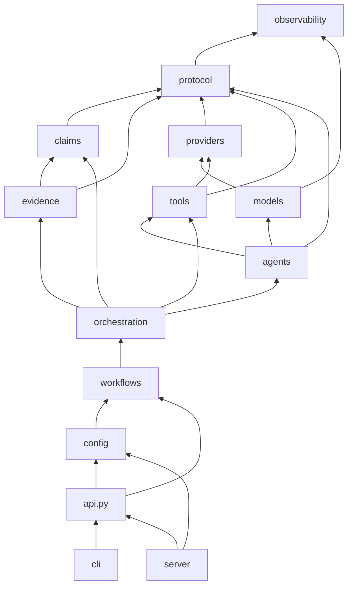

# Architecture

AdverSI is a layered library. The core is a small set of typed records and a workflow
engine; everything vendor-specific or interface-specific sits at the edges.

```text
src/adversi/
├── protocol/        Typed records: Claim, Evidence, Source, Perspective, Challenge, ... AdverSIResult
├── claims/          ClaimStore (dedupe, consolidation) and StatusPolicy (status validation)
├── evidence/        EvidenceStore (sources, citations) and excerpt verification
├── agents/          Role (data), Agent (role + model + tools), LLM-facing draft schemas
├── models/          Model: retries, timeouts, limits, cache, usage, budget; structured output parsing
├── providers/       ModelProvider interface, registry, OpenAI-compatible + Anthropic adapters
├── tools/           Tool / @tool, executor, calculator, web (fetch + search), documents (BM25)
├── orchestration/   RunContext: the per-run blackboard shared by steps
├── workflows/       Step, Workflow, built-in steps, modes and profiles
├── observability/   Event bus, sinks, usage tracker
├── evaluation/      Datasets, scorers, metrics, benchmark runner
├── render/          Markdown and HTML reports
├── config/          TOML/YAML schema, loader, builder
├── cli/             argparse CLI (no extra dependency)
├── server/          FastAPI app (optional extra) + built UI assets
├── api.py           AdverSI facade
└── testing.py       ScriptedProvider for tests and offline development
web/                 React + TypeScript UI (Vite); builds into server/static
```

## Dependency direction



Rules enforced by review (and partly by CI's "core without extras" job):

- `protocol` has no behaviour beyond serialization helpers.
- No core module imports `cli`, `server`, `fastapi` or a specific provider module.
- Providers know nothing about agents or workflows; they translate `ModelRequest` to a
  vendor API and back.
- Steps communicate only through `RunContext`, never by calling each other.

## A run, step by step

1. `Workflow.run()` creates an `EventBus`, a `UsageTracker` (installed in a context
   variable so every `Model` call is attributed and budget-checked), and a `RunContext`.
   User documents become `user_provided` sources.
2. Each `Step.run(ctx)` executes in order. A failing optional step is recorded and the run
   continues; a failing *required* step (by default `IndependentAnalysis`) or an exhausted
   budget stops the run. A partial `AdverSIResult` is always returned.
3. Agents call `Agent.respond(ctx, step=..., task=..., schema=...)`, which builds a system
   prompt (protocol rules + role + output JSON schema), runs a bounded tool-call loop,
   then parses and validates the JSON (with one repair attempt).
4. Steps convert drafts into records through the context: `ingest_claims` registers
   claims (exact-duplicate merge, attribution), verifies each citation, downgrades
   unearned `basis=evidence`, and links assumptions.
5. `Judgment` passes each proposed status through `StatusPolicy`; `Synthesis` bins claims
   deterministically from validated statuses and asks the synthesizer only for prose.
6. `RunContext.build_result()` computes uncertainty signals and assembles metadata
   (configuration snapshot, models per agent, steps, usage, errors) and the event trace.

## Two layers of schema

LLM-facing *drafts* (`adversi.agents.outputs`) are distinct from persisted *records*
(`adversi.protocol`). Drafts have no ids, statuses or verification flags; those are
assigned by code. This lets prompts evolve without breaking the result format, and makes
it structurally impossible for a model to mark its own citation as verified.

## Concurrency and cost

- Independent agents run concurrently (`asyncio.gather`), bounded by
  `Workflow(max_concurrency=...)` and per-model `max_concurrency` / `requests_per_minute`.
- `Model` caches by full request hash (opt-in), retries only retryable errors with
  jittered exponential backoff, and enforces timeouts.
- Async primitives and HTTP clients are kept per event loop, so `run_sync()` can be called
  repeatedly.

## Extension points

| Extend | How |
|---|---|
| Provider | Subclass `ModelProvider`; `register_provider()` or entry point `adversi.providers` |
| Tool | `Tool(...)` / `@tool`; `register_tool()` to make it available by name in config |
| Role | `Role(name, instructions)`; `register_role()` for config files |
| Step | Subclass `Step`, implement `async run(ctx)`; register in `STEP_BUILDERS` for config |
| Policy | Pass a configured or subclassed `StatusPolicy` |
| Scorer | Any object with `name` and `async score(item, result)` |
| Event sink | Any callable taking an `Event` |
